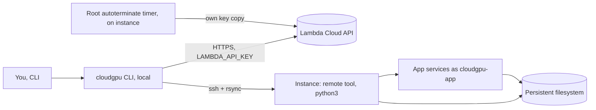

# cloudgpu — architecture

Last checked against: `710782a` on 2026-11-09

## Purpose and boundaries

A Python CLI that declaratively manages GPU machines on Lambda Cloud for one person: a config
(the hardware, and the profiles it should carry) plus profiles (what to install) go in, and
`cloudgpu up` finds capacity, launches, sets the machine up and installs or recovers the apps. Machines are disposable; the persistent
filesystem is what lasts, so a terminated instance is routine.

**Out of scope:** other cloud providers, a control-plane service or web UI, containers
(`plans/v2.md` "Non-goals"); anything needing pip on the instance (the remote side is stdlib-only).

## Components and data flow



| Component | Where | Does |
|---|---|---|
| CLI | `src/cloudgpu/cli.py` | Click commands: `up`, `down`, `provision`, `install`, `recover`, `status`, `ssh`, `forward`, `autoterminate`, `capacity`, `lambda` |
| Lambda client | `src/cloudgpu/local/lambda_api.py` | stdlib urllib; key from LAMBDA_API_KEY; test-only loopback override |
| Launch and liveness | `src/cloudgpu/local/orchestration.py`, `src/cloudgpu/local/liveness.py` | Poll capacity in the filesystem's region, classify launch outcomes, gone/alive/unknown |
| Configs and profiles | `src/cloudgpu/local/configs.py`, `src/cloudgpu/local/profiles.py` | configs/<name>.toml (hardware, owns the instance, and may list `profiles` that every `up` provisions, before any `-P` ones) and profiles/<name>/ folders |
| Transport | `src/cloudgpu/local/ssh.py`, `src/cloudgpu/local/sync.py` | ssh via subprocess; rsync the remote tool and write the instance marker |
| Capacity log | `src/cloudgpu/local/capacity.py` | One JSONL sample per run, for the v2 failover go/no-go |
| Local app registry | `src/cloudgpu/local/apps.py` | Ports, service-or-not, files `init` vendors |
| Remote entry | `src/cloudgpu/remote/__main__.py` | Runs on the instance over ssh; dispatches to installers |
| Installers | `src/cloudgpu/remote/installer.py`, `src/cloudgpu/remote/apps/` | `AppInstaller` per app (ComfyUI, AI Toolkit) |
| Instance guard | `src/cloudgpu/remote/instance.py` | Installers refuse to run without the root-owned marker |
| Records | `src/cloudgpu/remote/state.py`, `src/cloudgpu/remote/recovery.py` | state.json on the filesystem: installed apps and re-provision marks |
| Services | `src/cloudgpu/remote/service.py` | systemd units, sandboxed, run as `cloudgpu-app` |
| Run-as-app helper | `src/cloudgpu/remote/run_as_app.py` | Provisioning steps run as `cloudgpu-app` with only named env vars |
| Auto-terminate | `src/cloudgpu/remote/autoterminate.py` | Root-only timer that terminates the instance past its deadline |
| Profile templates | `src/cloudgpu/templates/comfyui/` | provision.py and comfylib.py, vendored into profiles |

## Where state lives

| State | Where | Survives a terminated instance? | Backed up? |
|---|---|---|---|
| Tracked instance (id, host, profiles) | configs/<name>.state.json beside the config (`src/cloudgpu/local/configs.py`), plus a configs/<name>.up.lock flock | yes (local) | no; gitignored |
| Manual-flow host | ~/.config/cloudgpu/config.json (`src/cloudgpu/local/config.py`) | yes (local) | no |
| Capacity samples | ~/.local/state/cloudgpu/capacity.jsonl, append-only | yes (local) | no |
| App records and re-provision marks | cloudgpu/state.json on the persistent filesystem | yes | no |
| Remote tool, launch scripts, apps, venvs, models | cloudgpu/remote, cloudgpu/bin, apps/, venvs/ on the filesystem | yes | no (v2 phase 3 plans a bucket sync) |
| Instance marker, autoterminate config with key | /var/lib/cloudgpu/instance, /etc/cloudgpu/ (instance disk) | no | no |

There are no migrations. The local state file is written atomically (a temporary file beside
it, synced, then renamed over it). One that exists but can't be read, or isn't a JSON object, is
never read as "no instance": every command that reads it stops and names the file. The README's layout shows .cloudgpu/ on the filesystem; the code uses cloudgpu/.

## Trust boundaries

| Actor | Gets in by | Can | Can't |
|---|---|---|---|
| You (local) | LAMBDA_API_KEY in your environment; your ssh keys | Launch, terminate, delete filesystems; everything below | — |
| `ubuntu` on the instance | ssh from the CLI | Run setup and provision scripts with every provisioning secret; passwordless sudo | — |
| App code, custom nodes (`cloudgpu-app`) | systemd service, or `src/cloudgpu/remote/run_as_app.py` | Write its own app dirs, venvs, its HOME and /tmp | Read the root-only Lambda key, see /home, write the OS, get tokens it wasn't named |
| Autoterminate timer (root) | systemd timer | Terminate this instance via the API | — |
| Tests | CLOUDGPU_TEST_LAMBDA_API_BASE | Point the client at a fake | Point it anywhere but a loopback IP |

Secrets on disk: provisioning tokens in ~/.config/cloudgpu/secrets.env (the README asks for mode
600; nothing checks it). It is copied to the instance as content, sourced, and deleted before
the provision entry point runs; profile rsyncs exclude it. The Lambda key goes to the instance
only for autoterminate, as content, into a root-only 600 file under /etc/cloudgpu.

## Invariants

| # | Invariant | Enforced by |
|---|---|---|
| I1 | A launch in doubt (502, dropped reply, timeout) ends with exactly one tracked instance | `tests/test_launch_in_doubt.py`: "test_502_on_launch_ends_with_exactly_one_tracked_instance" |
| I2 | The instance id is saved before the first boot poll | `tests/test_launch_tracking.py`: "test_state_holds_the_id_and_profiles_before_the_first_boot_poll" |
| I3 | Two concurrent `up`s on one config send one launch | `tests/test_launch_in_doubt.py`: "test_two_concurrent_ups_send_one_launch_and_one_refuses" |
| I4 | An unclear liveness read makes `up` stop with state unchanged | `tests/test_instance_liveness.py`: "test_up_stops_unchanged_when_the_tracked_read_is_unclear" |
| I5 | Installers refuse to run off a cloudgpu instance | `tests/test_instance_guard.py`: "test_refuses_without_marker_and_runs_nothing" |
| I6 | A failed reinstall of a recorded app stays recorded; a failed provision keeps the mark | `tests/test_records_marks_0_13.py`: "test_failed_reinstall_of_a_recorded_app_is_installed_again_by_the_next_recover", "test_failed_provision_keeps_the_mark" |
| I7 | Every app service runs sandboxed as `cloudgpu-app` | `tests/test_service.py`: "TestSandboxedAppUnit::test_comfyui_runs_as_unprivileged_user", "TestSandboxedAppUnit::test_every_installed_app_gets_the_sandbox" |
| I8 | A provisioning step gets only the tokens it names | `tests/test_provision_as_app.py`: "TestHelper::test_unnamed_token_does_not_reach_step" |
| I9 | secrets.env is gone from the instance before the provision entry point runs | `tests/test_cli_provision.py`: "test_secrets_file_deleted_before_provision_entry_runs" |
| I10 | The Lambda key goes to the instance as content, never on a command line | `tests/test_cli_autoterminate.py`: "test_arm_transfers_key_as_content_and_runs_remote" |
| I11 | The API override accepts loopback only, refused before any request | `tests/test_lambda_api_override.py`: "test_non_loopback_override_is_refused_before_any_request" |
| I12 | A failed capacity sample records nothing | `tests/test_capacity.py`: "test_api_error_exits_nonzero_and_leaves_the_file_unchanged" |
| I13 | Remote code is stdlib-only | **unenforced:** module docstrings say so; no import check (candidate) |
| I14 | A failed or interrupted save of the local state file leaves the previous file as it was, and no temporary file | `tests/test_state_file_2_2.py`: "TestSaveState::test_a_write_that_fails_partway_keeps_the_old_file", "TestSaveState::test_a_failed_replace_keeps_the_old_file" |
| I15 | No test reaches the real Lambda API | **unenforced:** tests monkeypatch or use the fake; nothing fails a test that would go to cloud.lambda.ai |
| I16 | secrets.env is mode 600 | **unenforced:** asked for in the README; the code never checks or sets it locally |
| I17 | During install and a venv rebuild, no program in an app venv (`bin/pip`, `bin/python3`) runs as `ubuntu`, and a pip step that can't run as `cloudgpu-app` fails the install | `tests/test_pip_as_app_0_1_fix.py`: "test_no_venv_program_runs_as_the_caller", "test_install_fails_when_a_pip_step_cannot_run_as_app" |
| I18 | A config's listed profile that can't be loaded stops `up` before the lock, any Lambda call or any state write | `tests/test_config_profiles_2_1.py`: "test_a_missing_config_profile_stops_up_before_anything_happens" |
| I19 | A local state file that can't be used stops every command that reads it, before any Lambda call, with the file unchanged | `tests/test_state_file_2_2.py`: "test_a_corrupt_state_file_stops_the_command" |

## Decisions

The plan record is `plans/v2.md` (phases, build items, decisions needed); it isn't repeated here.

- 2026-05-24 · A profile is a folder; hardware configs separate from profiles · one machine, many provisioning sets · ff6fbbf
- early · ssh/rsync via subprocess, stdlib-only remote, JSON state, stdlib urllib for Lambda · zero extra deps on either side · `README.md` "Design Decisions"
- 2026-10-24 · App services run as unprivileged, sandboxed `cloudgpu-app` (R3) · keep third-party nodes away from the Lambda key · 89ed274, e3bba60
- 2026-11-06 · v2 plan: incremental, disposable machines plus persistent storage stay · capacity waits · aad3aa8
- 2026-11-07 · Fake Lambda and loopback-only API override · run real `up` with no GPU or money · 8ecfb0f
- 2026-11-08 · Classify launch outcomes, look before relaunching, per-config up lock (R7) · never a second billed instance · 8d7d2bd
- 2026-11-08 · Installers need the instance marker (0.11); records and marks stay true (0.13) · d805b15, 0797120

## Family

Not a Bun-family app; the family design in ~/workspace/architect/FAMILY.md doesn't apply.

## How to verify a change

Rung 2 on the verifiability ladder (~/workspace/architect/VISION.md), for the local half only:
`tests/fake_lambda` starts a fake Lambda API on an ephemeral loopback port, in a temp directory,
with `ssh`/`rsync` shims, and drives the real `cloudgpu up` in a subprocess. Nothing runs the
remote half against a real instance, and there's no evidence script (rung 3).

```bash
uv run --frozen --extra dev pytest                     # whole suite, about 4.5 minutes
uv run --frozen --extra dev python -m tests.fake_lambda   # one scripted `up` against the fake
```

## Unverified

- Everything on a real instance: systemd sandbox behaviour, `sudo`, the marker, ComfyUI and AI
  Toolkit installs, the autoterminate timer firing (tests use fakes and recorded commands).
- Lambda's real API shapes where the fake marks an ASSUMPTION (`tests/fake_lambda/__init__.py`).
- The user's machine: whether secrets.env exists and its mode, which configs and profiles exist.
- That the persistent filesystem survives termination as Lambda documents (not testable here).
- `workflows/` (cloudgpu-build loop scripts) was not read beyond its file names.
