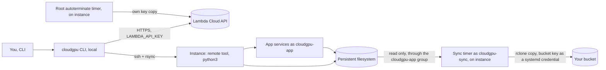

# cloudgpu — architecture

Last checked against: `03e9bb0` plus R29 on 2026-11-26

## Purpose and boundaries

A Python CLI that declaratively manages GPU machines on Lambda Cloud for one person: a config
(the hardware, and the profiles it should carry) plus profiles (what to install) go in, and
`cloudgpu up` finds capacity, launches, sets the machine up and installs or recovers the apps. Machines are disposable; the persistent
filesystem is what lasts, so a terminated instance is routine.

**Out of scope:** other cloud providers, a control-plane service or web UI, containers
(`plans/v2.md` "Non-goals"); anything needing pip on the instance (the remote side is stdlib-only).

## Components and data flow



| Component | Where | Does |
|---|---|---|
| CLI | `src/cloudgpu/cli.py` | Click commands: `up`, `down`, `provision`, `install`, `recover`, `status`, `ssh`, `forward`, `autoterminate`, `capacity`, `lambda` |
| Lambda client | `src/cloudgpu/local/lambda_api.py` | stdlib urllib; key from LAMBDA_API_KEY; test-only loopback override |
| Launch and liveness | `src/cloudgpu/local/orchestration.py`, `src/cloudgpu/local/liveness.py` | Poll capacity in the filesystem's region, classify launch outcomes, gone/alive/unknown |
| Configs and profiles | `src/cloudgpu/local/configs.py`, `src/cloudgpu/local/profiles.py` | configs/<name>.toml (hardware, owns the instance, and may list `profiles` that every `up` provisions, before any `-P` ones) and profiles/<name>/ folders |
| Transport | `src/cloudgpu/local/ssh.py`, `src/cloudgpu/local/sync.py` | ssh via subprocess; rsync the remote tool and write the instance marker |
| Capacity log | `src/cloudgpu/local/capacity.py` | One JSONL sample per run, for the v2 failover go/no-go |
| Local app registry | `src/cloudgpu/local/apps.py` | Ports, service-or-not, files `init` vendors |
| Remote entry | `src/cloudgpu/remote/__main__.py` | Runs on the instance over ssh; dispatches to installers |
| Installers | `src/cloudgpu/remote/installer.py`, `src/cloudgpu/remote/apps/` | `AppInstaller` per app (ComfyUI, AI Toolkit). An app directory holding only the names a restore from the bucket creates (its sync paths) is not an install (`needs_clone`); `clone_repo` then clones beside it and moves the checkout in, keeping every file already there |
| Instance guard | `src/cloudgpu/remote/instance.py` | Installers refuse to run without the root-owned marker |
| Records | `src/cloudgpu/remote/state.py`, `src/cloudgpu/remote/recovery.py` | state.json on the filesystem: installed apps, re-provision marks, and the record of a finished restore from the bucket (`get_restore`, `needs_restore`) |
| Services | `src/cloudgpu/remote/service.py` | systemd units, sandboxed, run as `cloudgpu-app` |
| Run-as-app helper | `src/cloudgpu/remote/run_as_app.py` | Provisioning steps run as `cloudgpu-app` with only named env vars |
| Auto-terminate | `src/cloudgpu/remote/autoterminate.py` | Root-only timer that terminates the instance past its deadline |
| Sync runner | `src/cloudgpu/remote/datasync.py` | Standalone: one run uploads the declared paths with `rclone copy` (never deletes, never follows symlinks) and records the last good run. Run by the timer that `up` sets up. Its `restore` entry is the other direction, once per filesystem: `rclone copy --ignore-existing` down per path first one `rclone lsf --max-depth 1 <name>:<bucket>`, and any failure of it (wrong key, missing bucket, no network) fails the restore as "the remote could not be reached" before anything is copied or recorded; then the copies (never replaces or deletes a local file, nothing through a symlink; a path missing from the bucket, rclone exit 3, is nothing to restore; any other failure fails), then a record (remote, UTC time) in state.json; with a record for the same remote it downloads nothing. With `--no-record` (the restricted run) it neither reads nor writes state.json |
| Sync setup | `src/cloudgpu/remote/datasync_setup.py` | Remote command `datasync setup/start/restore/final/remove`: creates the `cloudgpu-sync` user, moves the transferred bucket key to a root-only file, installs a pinned, checksum-verified rclone, a root-owned copy of the runner, its spec, and a oneshot service and timer; `start` enables the timer; `remove` takes timer, units, key, spec and runner away. Every `up` calls setup, start or remove (below). `restore` (called by every `up` with `[sync]`, between setup and start) restores a filesystem with no restore record: stops the timer and any upload in progress if running, creates missing declared directories as the provisioning user, runs the runner's `restore --no-record` in a one-off `systemd-run` unit as `cloudgpu-sync` with the upload's restrictions plus write access to the declared directories only, gives what arrived the `cloudgpu-app` group, group write and setgid, writes the restore record itself, and starts the timer again only if it had been running. `final` (not yet called by the CLI; `down` will) is the last upload before termination: fails in a sentence if spec, service unit or timer unit is missing; stops the timer; polls `systemctl show --property=ActiveState` until a run in progress has ended; then one blocking `systemctl start` of the service, a success only if that exits 0, the unit's `Result` is `success` and the last-success time is at or after the start; after any failure it starts the timer again and names the last successful sync time; after a success the timer stays stopped |
| Sync on `up` | `src/cloudgpu/cli.py` (`_plan_sync`, `_install_sync`, `_restore_from_bucket`, `_start_sync_timer`, `_remove_sync`), `src/cloudgpu/local/profiles.py` (`rclone_remote_section`) | With `[sync]` in the config: before any launch or ssh, checks ~/.config/cloudgpu/rclone.conf has the remote's section and works out the paths (`apps.sync_paths` for this `up`'s profiles plus the ones the state file records); then, inside the "arm the cap" step of every `up`, sends that one section and the path list as files, runs remote `datasync setup`, then `datasync restore` (the instance restores only a filesystem with no restore record for this remote; `up` says where from and shows what the instance said, including "already restored"), then `datasync start`. The restore is after the cap is armed and before the timer and before recovery, installs or restarts start any service. Without `[sync]`: runs `datasync remove`, and nothing about restore. A failure of any of these, a failed restore included, stops `up` before the slow steps, with the instance still tracked and the billing reminder |
| Profile templates | `src/cloudgpu/templates/comfyui/` | provision.py and comfylib.py, vendored into profiles |

## Where state lives

| State | Where | Survives a terminated instance? | Backed up? |
|---|---|---|---|
| Tracked instance (id, host, profiles) | configs/<name>.state.json beside the config (`src/cloudgpu/local/configs.py`), plus a configs/<name>.up.lock flock | yes (local) | no; gitignored |
| Bucket key (rclone config; you write it once, a section per remote) | ~/.config/cloudgpu/rclone.conf (`profiles.rclone_config_file`); needed by `up` only when the config has `[sync]`, never by `down` or `status` | yes (local) | no; nothing checks its mode |
| Manual-flow host | ~/.config/cloudgpu/config.json (`src/cloudgpu/local/config.py`) | yes (local) | no |
| Capacity samples | ~/.local/state/cloudgpu/capacity.jsonl, append-only | yes (local) | no |
| App records, re-provision marks, restore record | cloudgpu/state.json on the persistent filesystem | yes | no |
| Remote tool, launch scripts, apps, venvs, models | cloudgpu/remote, cloudgpu/bin, apps/, venvs/ on the filesystem | yes | only the declared sync paths, and only with `[sync]` in the config: the timer uploads them to your bucket (`src/cloudgpu/remote/datasync.py`; by default ComfyUI's output, input and user, and AI Toolkit's datasets and output). The rest, models and venvs included, is not |
| Instance marker, autoterminate config with key | /var/lib/cloudgpu/instance, /etc/cloudgpu/ (instance disk) | no | no |
| Bucket key (rclone config), sync spec, runner copy | /etc/cloudgpu/rclone.conf (root, 600), /etc/cloudgpu/datasync.json, /etc/cloudgpu/datasync.py (instance disk) | no | no; the key's original is ~/.config/cloudgpu/rclone.conf on your machine, and `up` sends the remote's section again each time |
| Pinned rclone | /usr/local/lib/cloudgpu/rclone-v<version>/rclone (root-owned, instance disk) | no | no; downloaded again and checked against the pinned SHA-256 |
| Time of the last complete sync | /var/lib/cloudgpu-sync/last-success (instance disk; directory owned by `cloudgpu-sync`, mode 750, so reading it over ssh needs sudo) | no | no |

There are no migrations. The local state file is written atomically (a temporary file beside
it, synced, then renamed over it). One that exists but can't be read, or isn't a JSON object, is
never read as "no instance": every command that reads it stops and names the file. The README's layout shows .cloudgpu/ on the filesystem; the code uses cloudgpu/.

## Trust boundaries

| Actor | Gets in by | Can | Can't |
|---|---|---|---|
| You (local) | LAMBDA_API_KEY in your environment; your ssh keys | Launch, terminate, delete filesystems; everything below | — |
| `ubuntu` on the instance | ssh from the CLI | Run setup and provision scripts with every provisioning secret; passwordless sudo | — |
| App code, custom nodes (`cloudgpu-app`) | systemd service, or `src/cloudgpu/remote/run_as_app.py` | Write its own app dirs, venvs, its HOME and /tmp | Read the root-only Lambda key, see /home, write the OS, get tokens it wasn't named |
| Autoterminate timer (root) | systemd timer | Terminate this instance via the API | — |
| Sync run (`cloudgpu-sync`) | systemd timer; the bucket key handed to each run by systemd `LoadCredential=` (systemd 247 or newer) | Read what the `cloudgpu-app` group can read; upload to the bucket; write /var/lib/cloudgpu-sync | Write anything on the persistent filesystem or the OS, use sudo, log in. `cloudgpu-app` can't read the key or /var/lib/cloudgpu-sync, or change rclone, the runner or its spec (all root-owned on the instance disk) |
| Tests | CLOUDGPU_TEST_LAMBDA_API_BASE | Point the client at a fake | Point it anywhere but a loopback IP |

Secrets on disk: provisioning tokens in ~/.config/cloudgpu/secrets.env (the README asks for mode
600; nothing checks it). It is copied to the instance as content, sourced, and deleted before
the provision entry point runs; profile rsyncs exclude it. The Lambda key goes to the instance
only for autoterminate, as content, into a root-only 600 file under /etc/cloudgpu. The bucket key
(an rclone config) is installed the same way at /etc/cloudgpu/rclone.conf by `datasync setup`,
which never opens it and deletes the transferred copy whether or not the install worked; a sync
run, which is not root, gets a per-run copy from systemd and never the file itself. The restore
run gets the key the same way, runs as the same user, and can write only the declared paths. On your
machine the bucket key lives in ~/.config/cloudgpu/rclone.conf, apart from secrets.env (which is
exported whole to provision scripts). `up` reads it with a plain ini parser (rclone is never run
locally), never prints a value or a parser error from it, and sends only the section named by
`[sync] remote`, as file content from a mode-600 file in a private temp dir that is removed
whatever happens; other remotes in the file stay behind.

## Invariants

| # | Invariant | Enforced by |
|---|---|---|
| I1 | A launch in doubt (502, dropped reply, timeout) ends with exactly one tracked instance | `tests/test_launch_in_doubt.py`: "test_502_on_launch_ends_with_exactly_one_tracked_instance" |
| I2 | The instance id is saved before the first boot poll | `tests/test_launch_tracking.py`: "test_state_holds_the_id_and_profiles_before_the_first_boot_poll" |
| I3 | Two concurrent `up`s on one config send one launch | `tests/test_launch_in_doubt.py`: "test_two_concurrent_ups_send_one_launch_and_one_refuses" |
| I4 | An unclear liveness read makes `up` stop with state unchanged | `tests/test_instance_liveness.py`: "test_up_stops_unchanged_when_the_tracked_read_is_unclear" |
| I5 | Installers refuse to run off a cloudgpu instance | `tests/test_instance_guard.py`: "test_refuses_without_marker_and_runs_nothing" |
| I6 | A failed reinstall of a recorded app stays recorded; a failed provision keeps the mark | `tests/test_records_marks_0_13.py`: "test_failed_reinstall_of_a_recorded_app_is_installed_again_by_the_next_recover", "test_failed_provision_keeps_the_mark" |
| I7 | Every app service runs sandboxed as `cloudgpu-app` | `tests/test_service.py`: "TestSandboxedAppUnit::test_comfyui_runs_as_unprivileged_user", "TestSandboxedAppUnit::test_every_installed_app_gets_the_sandbox" |
| I8 | A provisioning step gets only the tokens it names | `tests/test_provision_as_app.py`: "TestHelper::test_unnamed_token_does_not_reach_step" |
| I9 | secrets.env is gone from the instance before the provision entry point runs | `tests/test_cli_provision.py`: "test_secrets_file_deleted_before_provision_entry_runs" |
| I10 | The Lambda key goes to the instance as content, never on a command line | `tests/test_cli_autoterminate.py`: "test_arm_transfers_key_as_content_and_runs_remote" |
| I11 | The API override accepts loopback only, refused before any request | `tests/test_lambda_api_override.py`: "test_non_loopback_override_is_refused_before_any_request" |
| I12 | A failed capacity sample records nothing | `tests/test_capacity.py`: "test_api_error_exits_nonzero_and_leaves_the_file_unchanged" |
| I13 | Remote code is stdlib-only | **unenforced:** module docstrings say so; no import check (candidate) |
| I14 | A failed or interrupted save of the local state file leaves the previous file as it was, and no temporary file | `tests/test_state_file_2_2.py`: "TestSaveState::test_a_write_that_fails_partway_keeps_the_old_file", "TestSaveState::test_a_failed_replace_keeps_the_old_file" |
| I15 | No test reaches the real Lambda API | **unenforced:** tests monkeypatch or use the fake; nothing fails a test that would go to cloud.lambda.ai |
| I16 | secrets.env is mode 600 | **unenforced:** asked for in the README; the code never checks or sets it locally |
| I17 | During install and a venv rebuild, no program in an app venv (`bin/pip`, `bin/python3`) runs as `ubuntu`, and a pip step that can't run as `cloudgpu-app` fails the install | `tests/test_pip_as_app_0_1_fix.py`: "test_no_venv_program_runs_as_the_caller", "test_install_fails_when_a_pip_step_cannot_run_as_app" |
| I18 | A config's listed profile that can't be loaded stops `up` before the lock, any Lambda call or any state write | `tests/test_config_profiles_2_1.py`: "test_a_missing_config_profile_stops_up_before_anything_happens" |
| I19 | A local state file that can't be used stops every command that reads it, before any Lambda call, with the file unchanged | `tests/test_state_file_2_2.py`: "test_a_corrupt_state_file_stops_the_command" |
| I20 | `up` reports success and exits 0 only if every service app on the machine (recorded apps plus this `up`'s) is running as systemd on the instance reports it, after a settle when `up` restarted them; a check that can't be made is a failure, and a failed verify changes nothing | `tests/test_up_verify_2_3.py`: "test_up_fails_when_a_service_is_not_running_after_the_restart", "test_up_fails_in_a_sentence_when_the_check_cannot_be_made" |
| I21 | Only the config's own remote section of rclone.conf goes to the instance, as file content; the bucket key is in no ssh or rsync command line, no ssh environment and no output | `tests/test_datasync_up_3_2.py`: "test_only_the_remotes_section_travels_and_the_key_is_in_no_command" |
| I22 | With `[sync]` and no usable key section, `up` stops before any Lambda call or ssh; a failed sync setup, restore, start or removal fails `up` with the instance still tracked, and after a failed restore `up` runs nothing more on the instance | `tests/test_datasync_up_3_2.py`: "test_up_with_sync_stops_before_any_launch_or_ssh_without_the_key", "test_a_failed_remote_sync_step_fails_up_in_a_sentence_and_keeps_the_instance" (setup, start, removal); `tests/test_up_restore_3_3.py`: "test_a_failed_restore_fails_up_in_a_sentence_and_starts_nothing" (restore) |
| I23 | A restore never replaces a file that is already on the filesystem: every restore copy is `rclone copy --ignore-existing` | `tests/test_datasync_restore_3_3.py`: "test_existing_local_file_is_left_byte_for_byte" (a fake rclone that honours the flag; no real rclone has run) |
| I24 | A filesystem with a restore record for the same remote is not restored again: nothing is copied, so a file deleted on the instance stays deleted | `tests/test_datasync_restore_3_3.py`: "test_second_run_makes_no_rclone_call_and_says_already_restored" (the runner); `tests/test_datasync_restore_setup_3_3.py`: "test_an_already_restored_filesystem_runs_nothing_and_says_when" (the `datasync restore` command that `up` calls) |
| I25 | `up` calls the restore after the cap is armed, and before the sync timer and before recovery, installs or restarts start any service | `tests/test_up_restore_3_3.py`: "test_restore_runs_after_install_and_cap_before_timer_and_any_service" |
| I26 | A passed auto-terminate deadline with an instance Lambda still shows alive and not terminating is reported on stderr by every command that reads the config's state to act on the instance (`status`, `up`, `autoterminate`, `down`), and fails `status`; the check only reports, and makes no Lambda call unless the saved deadline has passed | `tests/test_overdue_and_down_confirms.py`: "test_status_exits_1_and_names_the_overdue_instance", "test_other_commands_print_the_overdue_error_and_keep_their_exit_code", "test_a_future_deadline_makes_no_lambda_read" |
| I27 | `down` clears the local state only once the API shows the instance terminating, terminated or gone; a termination not confirmed within 60 seconds exits 1 with the state file unchanged and no filesystem step | `tests/test_overdue_and_down_confirms.py`: "test_down_keeps_the_state_when_the_termination_does_not_take", "test_down_gives_up_after_60_seconds_and_keeps_the_state", "test_down_delete_filesystem_stops_before_the_filesystem_when_unconfirmed" |

## Decisions

The plan record is `plans/v2.md` (phases, build items, decisions needed); it isn't repeated here.

- 2026-05-24 · A profile is a folder; hardware configs separate from profiles · one machine, many provisioning sets · ff6fbbf
- early · ssh/rsync via subprocess, stdlib-only remote, JSON state, stdlib urllib for Lambda · zero extra deps on either side · `README.md` "Design Decisions"
- 2026-10-24 · App services run as unprivileged, sandboxed `cloudgpu-app` (R3) · keep third-party nodes away from the Lambda key · 89ed274, e3bba60
- 2026-11-06 · v2 plan: incremental, disposable machines plus persistent storage stay · capacity waits · aad3aa8
- 2026-11-07 · Fake Lambda and loopback-only API override · run real `up` with no GPU or money · 8ecfb0f
- 2026-11-08 · Classify launch outcomes, look before relaunching, per-config up lock (R7) · never a second billed instance · 8d7d2bd
- 2026-11-08 · Installers need the instance marker (0.11); records and marks stay true (0.13) · d805b15, 0797120

## Family

Not a Bun-family app; the family design in ~/workspace/architect/FAMILY.md doesn't apply.

## How to verify a change

Rung 2 on the verifiability ladder (~/workspace/architect/VISION.md), for the local half only:
`tests/fake_lambda` starts a fake Lambda API on an ephemeral loopback port, in a temp directory,
with `ssh`/`rsync` shims, and drives the real `cloudgpu up` in a subprocess. The one-command
scripted run below drives `up` and then `down`, and reports that the fake has no live instance
left. The fake can also accept a terminate and keep the instance (`terminate_takes=False`), which
is how I27 is tested. Nothing runs the remote half against a real instance,
and there's no evidence script (rung 3).

```bash
uv run --frozen --extra dev pytest                     # whole suite, about 7 minutes (6:57 on 2026-11-26: 1129 passed, 1 skipped)
uv run --frozen --extra dev python -m tests.fake_lambda   # one scripted `up`, then `down`, against the fake
```

## Unverified

- Everything on a real instance: systemd sandbox behaviour, `sudo`, the marker, ComfyUI and AI
  Toolkit installs, the autoterminate timer firing (tests use fakes and recorded commands).
- Sync and restore on a real instance: that systemd there has `LoadCredential=` (247 or newer),
  that `cloudgpu-sync` can read the synced dirs and `cloudgpu-app` can't read the key, that the
  pinned rclone downloads and runs, that the timer fires, and that a real rclone restores without
  replacing a file (I23 to I25 are proven against a fake rclone and an ssh shim). `up`'s calls are
  tested only against ssh shims: no real `datasync setup` or restore has ever run.
- The overdue report and `down`'s confirmation (I26, I27) on a real instance: no real cap has
  failed with a rotated key, and no real Lambda termination has been seen not to take; that Lambda
  ever answers 200 to a terminate that doesn't happen is the fake's ASSUMPTION. The on-instance
  timer is unchanged: when its call fails it still only logs there and retries. The overdue report
  is only seen when you run a command for that config; nothing notifies you otherwise.
- `datasync final` on real systemd: that a oneshot run in progress shows `ActiveState` "activating",
  that `systemctl start` of it blocks until the run ends and exits non-zero when it failed, and
  that `Result` reads `success` after a good run. Written from memory, tested against a recorder.
- Lambda's real API shapes where the fake marks an ASSUMPTION (`tests/fake_lambda/__init__.py`).
- The user's machine: whether secrets.env and rclone.conf exist and their modes, which configs and profiles exist.
- That the persistent filesystem survives termination as Lambda documents (not testable here).
- `workflows/` (cloudgpu-build loop scripts) was not read beyond its file names.
